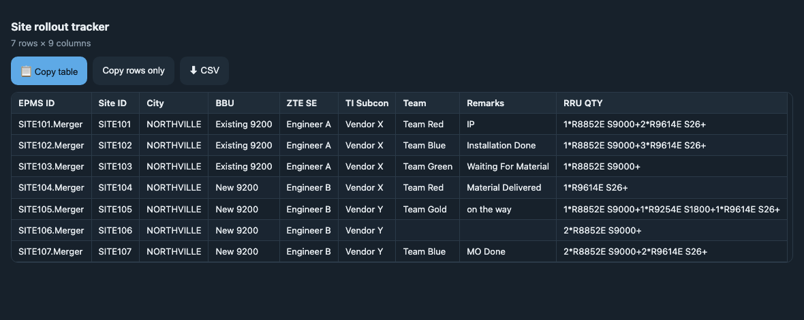
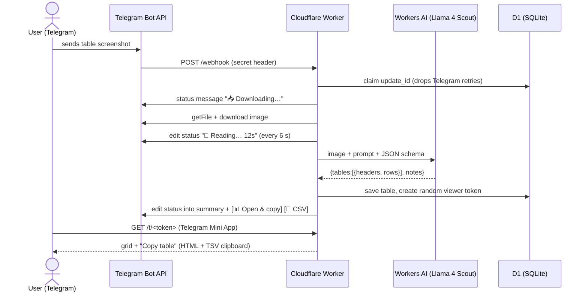

# Image → Excel Telegram Bot

**Send a screenshot of a table to Telegram, paste it into Excel as real cells a few seconds later.**
Serverless, AI-powered, and running entirely on Cloudflare's free tier.

[](https://github.com/MubeenAmjad205/image-to-excel/actions/workflows/ci.yml)


[](LICENSE)

<p align="center">
  
</p>
<p align="center"><sub>The table viewer the bot opens inside Telegram (demo data). One tap copies the table so every value lands in its own spreadsheet cell.</sub></p>

## The problem

Telecom rollout teams share site status as screenshots of spreadsheets in chat groups: site IDs,
equipment codes like `1*R8852E S9000+2*R9614E S26+`, installation status. Someone then retypes
them into Excel. It is slow, and one wrong character in a site ID breaks reporting.

## What it does

| You send | You get |
|---|---|
| A photo or image file of a table | A live status message ("📥 Downloading… → 🔎 Reading… 12s → ✅"), then a summary with **📊 Open & copy** |
| Tap **Open & copy → Copy table** | The table on your clipboard as HTML + TSV. Pastes into Excel, Google Sheets or Numbers as cells, codes kept as text |
| A caption such as `split RRU QTY by +` | The extraction follows the instruction |
| A question: `how many sites are Installation Done?` | An answer from the tables you sent. Changed tables come back with the same copy button |
| `/csv`, `/tsv` | A file, only when you ask for it |
| `/hq` | A re-read with Claude when a table really matters (optional, off by default) |

## Results

| Metric | Value |
|---|---|
| Cell accuracy, default model, real screenshots | **146 of 147 cells exact (99.3 %)**, see [evaluation](docs/evaluation.md) |
| Models benchmarked | 7 vision models from the Workers AI catalog |
| Time per image | about 25–50 s, with live progress |
| Hosting and AI cost | **$0** on Cloudflare's free tier |
| Paste steps | 2 taps, then paste |

## How it works



The flow, components and data model are documented in [docs/architecture.md](docs/architecture.md).

## Engineering highlights

- **Picked the approach by measuring it.** Plain OCR followed by an LLM loses column boundaries,
  so empty cells shift values into the wrong column. Sending the image to a vision model with a strict
  JSON schema keeps the structure. I built an [evaluation harness](scripts/eval.ts) that scores every
  cell against hand-checked answers, ran 7 models, and kept the most accurate free one
  ([decision record](docs/decisions/0006-default-vision-model.md)).
- **Debugged a regional network failure.** Telegram is blocked from Cloudflare's Lahore data center,
  which showed up as hanging requests and `525` errors. I traced it with `wrangler tail` and the
  `cf-placement` header. The fixes were per-attempt timeouts with exponential backoff, a `/setup` route
  run from GitHub Actions, and a per-request `events` table that records which data center served each update.
  I rejected routing through a third-party proxy, because it would have exposed the bot token.
- **Designed around real UX feedback.** The first version replied with tab-separated text. A real user
  showed that Telegram renders tabs as spaces, so columns blurred together. I replaced it with a Telegram
  Mini App whose Copy button writes HTML and TSV to the clipboard together, and marks cells as text so
  Excel does not turn `51.1.1` into a date ([decision record](docs/decisions/0005-table-viewer-page.md)).
- **Kept users informed during slow AI calls.** Each request has one status message that is edited
  in place through every step and then becomes the answer. Edits go through a queue so a late progress
  edit can never overwrite the result. Errors are rewritten into plain advice.
- **Security by default.** The webhook is verified with a shared secret. Viewer links use 144-bit random
  tokens and are sent with `noindex` and `no-store`. All cell text is HTML-escaped and data embedded in
  the page is `<`-escaped, with tests for both. Access is limited to an allowlist of chats kept in a
  secret, and no secrets or real data are in the repo.
- **Free-tier constraints treated as requirements.** No Node-only APIs and no heavy WASM: the bundle
  is about 160 KB gzipped. Work runs inside the webhook request, which avoids the 30-second `waitUntil`
  limit, and duplicate deliveries are dropped through a D1 claim.
- **Optional paid fallback without lock-in.** `/hq` uses the official Anthropic SDK with structured
  outputs and refusal handling. It is only active when an API key is set, so the bot works fully without it.

## Tech stack

| Layer | Technology |
|---|---|
| Runtime | Cloudflare Workers, TypeScript (strict) |
| AI | Workers AI vision models (default Llama 4 Scout 17B), optional Claude via `@anthropic-ai/sdk` |
| Storage | Cloudflare D1 (SQLite): tables, chat history, viewer tokens, request events |
| Interface | Telegram Bot API (webhooks, inline keyboards, Mini App), HTML/CSS/vanilla JS viewer |
| Quality | Node test runner, `tsc` typecheck, GitHub Actions CI, model evaluation harness |
| Ops | Wrangler, Workers Logs, GitHub Actions for webhook setup |

## Project structure

```
src/
  index.ts       webhook entry, routing, commands, replies
  extract.ts     image → table (Workers AI, Claude), chat answers
  progress.ts    live status message + friendly errors
  telegram.ts    Bot API client with timeouts and retries
  page.ts        table viewer page (Mini App)
  format.ts      TSV/CSV, parsing, escaping (pure, unit tested)
  store.ts       D1 access
  types.ts       env, types, extraction prompt and JSON schema
test/            unit tests (formatting, page security, retries, progress)
scripts/eval.ts  model accuracy benchmark
docs/            architecture, decisions, evaluation, runbook, plan, rules
```

## Run it yourself

You need a Cloudflare account (free), Node 24, and a bot token from [@BotFather](https://t.me/BotFather).

```sh
git clone https://github.com/MubeenAmjad205/image-to-excel && cd image-to-excel
npm install
npx wrangler login
npx wrangler d1 create image-to-excel        # put the id in wrangler.jsonc
npm run db:init
npx wrangler secret put TELEGRAM_BOT_TOKEN
npx wrangler secret put TELEGRAM_WEBHOOK_SECRET
npm run deploy
curl -X POST -H "x-setup-key: <your webhook secret>" https://<your-worker>.workers.dev/setup
```

Set `PUBLIC_URL` in `wrangler.jsonc` to your Worker URL. Optional secrets are `ALLOWED_CHAT_IDS`
(comma-separated, locks the bot to those chats) and `ANTHROPIC_API_KEY` (enables `/hq`).
The full runbook, including troubleshooting, is in [docs/runbook.md](docs/runbook.md).

## Quality

```sh
npm run typecheck   # strict TypeScript, Worker code kept free of Node APIs
npm test            # formatting, XSS-safety of the viewer, retry and progress behaviour
npm run eval        # cell-level accuracy of vision models on your own samples
```

CI runs the typecheck and tests on every push.

## Documentation

| Doc | What's in it |
|---|---|
| [Architecture](docs/architecture.md) | Request flow, reply format, data model, config |
| [Decision records](docs/decisions/) | Six records: why Workers, why vision instead of OCR, the viewer page, model choice, and more |
| [Evaluation](docs/evaluation.md) | Model benchmark method and results |
| [Runbook](docs/runbook.md) | Deploy, secrets, diagnosing requests |
| [Plan](docs/plan.md) | Phases, status, roadmap |
| [Agent guide](AGENTS.md) | Rules and context for AI coding agents working on the repo |

## Roadmap

- More benchmark samples and repeat runs
- Caption shortcuts (`split <column> by <sep>`, `keep rows where …`)
- Status column from row colours
- Expiring viewer links, scheduled cleanup
- Optional append to Google Sheets

## Author

**Mubeen Amjad** · [GitHub @MubeenAmjad205](https://github.com/MubeenAmjad205)

Built to solve a real reporting chore in telecom site rollouts, and used on real team data.
Licensed under [MIT](LICENSE).
